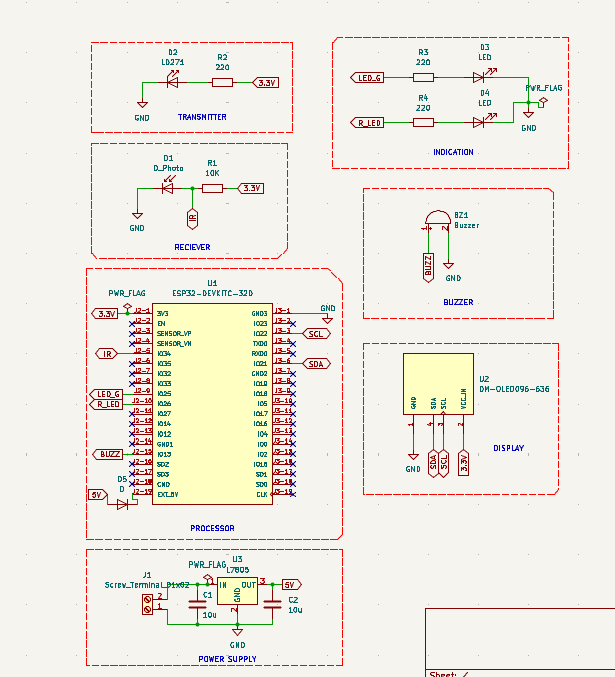
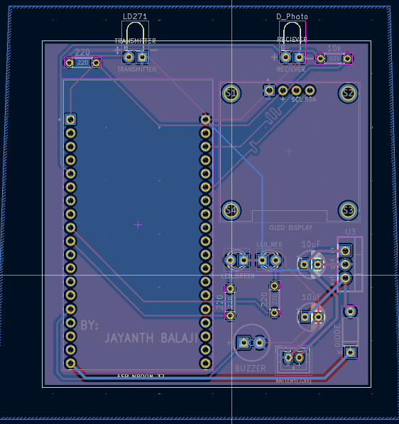

# IR Drip Counter

An ESP32-based IV drip drop counter designed using KiCad.

## Features
- Infrared-based drop detection
- ESP32 microcontroller
- OLED display using I2C
- Green and red LED indicators
- Buzzer alert system
- Custom PCB design

## Hardware Components
- ESP32 DevKit
- Infrared LED
- Photodiode / Phototransistor receiver
- OLED I2C display
- Green LED
- Red LED
- Buzzer
- Current-limiting resistors
- Voltage regulator

## Design Software
- KiCad 9.0

## Project Files
- `.kicad_sch` — Circuit schematic
- `.kicad_pcb` — PCB layout
- `.kicad_pro` — Project settings

## Project Status
PCB design and hardware development in progress.

## Circuit Schematic

## Modified Circuit Schematic

## PCB Layout

## 3D PCB View

## Working Principle

The IR transmitter emits infrared light across the IV drip chamber.
The receiver detects changes in the received light when a drop passes
through the beam.

The ESP32 processes the sensor signal, counts detected drops, and
updates the OLED display. LEDs and a buzzer provide visual and
audible indications.

## Hardware Components

- ESP32 DevKit
- Infrared LED transmitter
- Photodiode / phototransistor receiver
- 0.96-inch I2C OLED display
- Green LED
- Red LED
- Buzzer
- Resistors
- Voltage regulator

## Software and Tools

- KiCad 9.0 — schematic and PCB design
- Arduino IDE — ESP32 firmware development

## Project Status

PCB design and hardware development in progress.

## Disclaimer

This is an educational prototype, not a medical-grade device.
It must not be used to make clinical decisions or control patient
fluid delivery.
## Disclaimer
This is an educational prototype, not a medical-grade device.
It must not be used to make clinical decisions or control patient fluid delivery.
